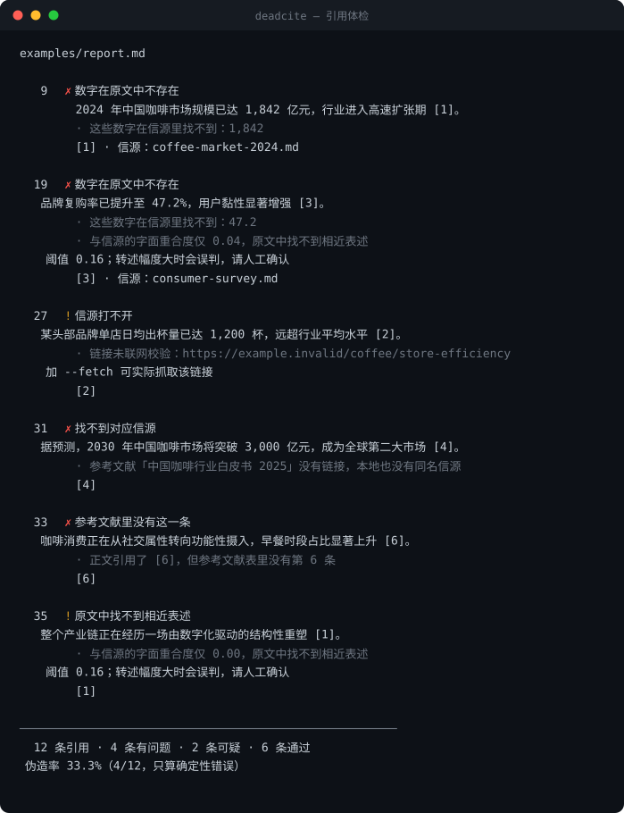

<div align="center">

# deadcite

**输入报告和信源，逐条告诉你哪条引用站不住。**

[](https://github.com/DIUDIU1HAO/deadcite/actions/workflows/ci.yml)
[](https://www.python.org)
[](LICENSE)
[](pyproject.toml)

</div>

<div align="center">
  
</div>

## 30 秒跑通

```bash
pip install git+https://github.com/DIUDIU1HAO/deadcite.git

git clone https://github.com/DIUDIU1HAO/deadcite && cd deadcite
python -m deadcite examples/report.md
```

`examples/` 里是一份**虚构的**咖啡行业报告，故意埋了五类问题。预期结果：12 条引用、4 条确证有问题、2 条可疑，退出码 `1`。

## 输出长这样

```
examples/report.md

   9  ✗ 数字在原文中不存在
        2024 年中国咖啡市场规模已达 1,842 亿元，行业进入高速扩张期 [1]。
        · 这些数字在信源里找不到：1,842
        [1] · 信源：coffee-market-2024.md

  33  ✗ 参考文献里没有这一条
        咖啡消费正在从社交属性转向功能性摄入，早餐时段占比显著上升 [6]。
        · 正文引用了 [6]，但参考文献表里没有第 6 条
        [6]

──────────────────────────────────────────────────────
  12 条引用 · 4 条有问题 · 2 条可疑 · 6 条通过
  伪造率 33.3%（4/12，只算确定性错误）
```

终端宽度决定折行，管道与重定向时自动输出纯文本（同时支持 `NO_COLOR`、`TERM=dumb`、`--no-color`），不会把 ANSI 转义写进日志文件。

## 五类判定

| 判定 | 依据 | 强度 |
|---|---|---|
| **悬空引用** | 正文有 `[7]`，参考文献里没有第 7 条 | 确证 |
| **无可定位来源** | 条目没有链接，本地也没有对应文件 | 确证 |
| **数字不存在** | 报告里的数字在信源全文中找不到 | 确证 |
| **链接打不开** | 请求失败或域名无法解析（需 `--fetch`） | 确证 |
| **表述无对应** | 与信源最佳片段字面重合度低于阈值 | 可疑 |

前四类不依赖任何猜测，是可以机械验证的事实；第五类只是**提醒你去看一眼**，不构成结论。

所以汇总里「伪造率」只统计前四类，可疑单独列出。**一个分不清「确证」和「可疑」的检测工具，会很快失去信任。**

## 它解决什么问题

用 AI 写行业报告、竞品分析、文献综述，最危险的失败不是「写得差」，而是**引用是假的**，而且假得很像真的：

- 报告写「市场规模达到 **1,842** 亿元」，原文写的是 **1,284** 亿元。一个数字之差，结论方向可能就反了。
- 正文引用了 `[7]`，参考文献表里只有 5 条。
- 参考文献里挂着一个链接，点开是 404，或者这个域名根本不存在。
- 每条引用都格式正确、排版漂亮，但没有任何一条能对上原文。

这类错误人眼几乎无法发现：一份 30 页的报告有 40 条引用，逐条点开原文核对数字，一整天就没了。而它出现在对外文档里的代价最高。

## 它怎么工作

```
report.md ──┬─→ 拆出带引用的句子 ──┐
            │                     ├─→ 逐条判定 ─→ 确证问题 / 可疑 / 通过
sources/ ───┴─→ 切块并建索引 ──────┘
```

四步，全部可离线：

1. **切句**：跳过代码块、行内代码、图片与参考文献表，只留下真正带引用的论断。
2. **定位目标**：编号引用去参考文献表取链接；行内链接直接取 URL；再落到本地信源或实际请求。
3. **比对数字**：把句子里的数字与目标信源全文的数字集合求差。差集非空就是确证幻觉。
4. **比对字面**：句子与信源所有段落的最佳重合度，低于阈值只记为可疑。

## 为什么不用大模型来判断

「这句话是否被原文支持」本质是语义判断，用 LLM 做看起来最省事，但会引入两个新问题：模型自己可能幻觉出「支持」的结论；成本与延迟让它在 CI 里跑不起来。

`deadcite` 只做**能机械验证的部分**：来源是否存在、数字是否真的在原文里、字面是否对得上。它宁可变保守，也不给出没有依据的指控。

## 完整用法

```bash
deadcite report.md                    # 信源自动取同目录的 sources/
deadcite report.md -s sources/        # 指定信源
deadcite report.md --fetch            # 对引用里的链接实际发起请求
deadcite report.md --json > out.json  # 机器可读
deadcite report.md -q                 # 只留汇总，适合进 CI 日志
deadcite report.md --fail-on suspect  # 可疑也判失败（严格模式）
```

退出码：`0` 未发现问题 / `1` 达到 `--fail-on` 阈值 / `2` 参数或读取错误。完整参数见 `deadcite --help`。

加 `--fetch` 后样例里的第五条问题（死链）才会被触发，预期是 5 条确证有问题。

## 测试

```bash
python -m pytest -q        # 31 passed
```

测试覆盖五类判定的正反例，以及四类已知误报的回归（行内代码、徽章图片、图片外壳链接、JSON 输出形状），另有终端呈现的回归：非 TTY 不出 ANSI、`NO_COLOR` 降级、折行不超显示宽度、JSON 契约字段。规则可以少，误报不能有——所以每一条新规则都要求带一个「不该报」的用例。

## 输出格式

终端如上。JSON（供流水线消费，**始终是数组**，一个报告一个元素）：

```json
[
  {
    "schema_version": 1,
    "tool": "deadcite",
    "version": "0.2.0",
    "file": "report.md",
    "threshold": 0.16,
    "fail_on": "problem",
    "summary": {
      "total": 12, "problems": 4, "suspects": 2, "ok": 6, "problem_ratio": 0.3333
    },
    "citations": [
      {
        "line": 9,
        "status": "problem",
        "source": "coffee-market-2024.md",
        "issues": [{"kind": "NUMBER_NOT_FOUND", "severity": "problem"}]
      }
    ]
  }
]
```

字段只增不改，`schema_version` 变化才表示有破坏性调整；诊断信息一律走 stderr，所以 `deadcite report.md --json | jq .[0].summary` 永远拿到干净 JSON。

## 接到生成流水线后面

报告是生成物，所以最合适的接入点是**生成之后、发布之前**：

```yaml
- run: |
    pip install git+https://github.com/DIUDIU1HAO/deadcite.git
    deadcite output/report.md -s sources/ --fail-on problem
```

也支持 `pre-commit`，配置见 `.pre-commit-hooks.yaml`（默认只检查 `reports/` 目录下的文件，按需改 `files`）。

## 给 Agent 用

仓库内含 `skills/deadcite/SKILL.md`，可直接放进 Claude Code / Cursor / Codex 的技能目录。装好之后，你说「检查这份报告的引用靠不靠谱」，Agent 就会自己跑一遍并区分哪些是确证错误、哪些只是可疑。

这一层很关键：报告是 AI 生成的，校验也应该由 AI 主动发起，而不是等人想起来手动跑。

## 它不能做什么

边界讲清楚，比多写功能重要：

- **不判断论点对不对**。它只验证「引用是否真实存在、数字是否对得上」，不评价结论。
- **信源格式目前只支持文本类**（`.md` / `.txt` / `.html` / `.csv`）。PDF 与 Word 解析在 Roadmap 里。
- **数字校验只看数字本身**。`1,284 亿元` 配 `1,284 万美元` 的原文会漏过去——单位语义不在本期范围内。
- **字面重合度对大幅改写会误判**。一段被彻底重写的正确转述，可能被判「可疑」；这也是它只算可疑、不算确证的原因。
- **正文里的普通 Markdown 链接也算引用来源**。报告里「据[统计局](url)数据」是常见引用形式，所以保留了这个能力；代价是拿它检查纯文档类 Markdown 时会有噪音，那种场景建议只用编号引用。

## Roadmap

- [ ] PDF / Word 信源解析，复用坐标排序还原双栏与表格
- [ ] span 级定位：把引用精确到源文的段落与句子，而不只是「文件」
- [ ] 单位与量纲校验（亿元 / 万元 / % 之间的一致性与换算）
- [ ] 与调研流水线集成：生成时就把 citation 绑定到检索结果，写报告时直接校验

## 与同类工具的关系

引用格式检查（CSL、GB/T 7714 校验）管的是「引用写法对不对」；事实核查工具管的是「这句话真不真」，通常依赖 LLM 与外部知识库。`deadcite` 卡在中间那层：**引用指向的东西是否真的存在、里面的数字是否真的是那个数字。** 这一层可以离线跑、零成本、结果可复现。

## License

MIT
